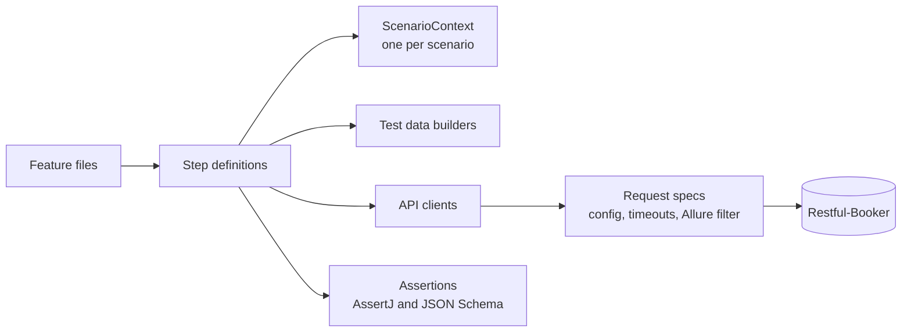

# Java API Test Framework

A Java API test automation framework built with REST Assured, Cucumber, JUnit 5, Gradle and Allure, running against the
public [Restful-Booker](https://restful-booker.herokuapp.com/apidoc/index.html) API.

## Quick Start

Requires JDK 21 (Gradle downloads one automatically if it's missing).

```bash
./gradlew test                                  # full suite against the public API
./gradlew test -Dcucumber.filter.tags="@smoke"  # only smoke scenarios
./gradlew test -Dcucumber.filter.tags="@booking and not @negative"
```

View the report locally with the [Allure CLI](https://allurereport.org/docs/install/):

```bash
allure serve build/alllure-results
```

A plain Cucumber HTML report is also written to `build/reports/cucumber/cucumber.html`.

## How it is built



```
java-api-test-framework/
├── gradle/
│   ├── wrapper/
│   │   ├── gradle-wrapper.jar                              Gradle wrapper binary
│   │   └── gradle-wrapper.properties                       Pins Gradle 9.3.0
│   └── libs.versions.toml                                  Version catalog: all dependency versions in one place
├── src/
│   └── test/
│       ├── java/
│       │   └── com/
│       │       └── davidsusanto/
│       │           └── api/
│       │               ├── client/
│       │               │   ├── AuthClient.java             POST /auth, admin token helper
│       │               │   ├── BookingClient.java          /booking endpoints (search, get, create, update, patch, delete)
│       │               │   ├── HealthClient.java           GET /ping
│       │               │   └── Specs.java                  Request specs: base URL, headers, timeouts, Allure filter
│       │               ├── config/
│       │               │   ├── TestConfig.java             Environment selection and -D / env-var overrides
│       │               │   └── TestConfigTest.java         JUnit 5 unit test for config key mapping
│       │               ├── context/
│       │               │   └── ScenarioContext.java        Per-scenario state, injected by PicoContainer
│       │               ├── data/
│       │               │   ├── BookingBuilder.java         Test data builder with unique, parallel-safe data
│       │               │   └── BookingBuilderTest.java     JUnit 5 unit tests for the builder
│       │               ├── hooks/
│       │               │   └── Hooks.java                  Run setup (@BeforeAll) and data cleanup (@After)
│       │               ├── model/
│       │               │   ├── AuthRequest.java            Records matching the API's JSON
│       │               │   ├── AuthResponse.java
│       │               │   ├── Booking.java
│       │               │   ├── BookingDates.java
│       │               │   ├── BookingId.java
│       │               │   └── CreateBooking.java 
│       │               ├── steps/
│       │               │   ├── AuthSteps.java              Authentication steps
│       │               │   ├── BookingSteps.java           Booking and search steps
│       │               │   └── CommonSteps.java            Status code, schema validation, ping
│       │               ├── support/
│       │               │   ├── AllureEnvironment.java      Writes report environment info and failure categories
│       │               │   └── ServiceReadiness.java       Waits for /ping before the run starts
│       │               └── RunCucumberTest.java            JUnit Platform suite that Gradle discovers
│       └── resources/
│           ├── allure/ 
│           │   └── categories.json                         Failure categories shown in the Allure report
│           ├── config/
│           │   ├── local.properties                        Restful-Booker in Docker (localhost:3001)
│           │   └── public.properties                       restful-booker.herokuapp.com (default)
│           ├── features/
│           │   ├── auth.feature
│           │   ├── booking_lifecycle.feature
│           │   ├── booking_search.feature
│           │   └── health.feature
│           ├── schemas/
│           │   ├── auth-token.json                         JSON schemas for each response type
│           │   ├── booking-ids.json
│           │   ├── booking.json
│           │   └── created-booking.json
│           ├── allure.properties                           Allure results directory
│           └── junit-platform.properties                   Cucumber plugins, default tags, parallelism
├── .gitattributes                                          Line endings for gradlew / .bat, jar as binary
├── .gitignore
├── build.gradle.kts                                        Dependencies and test task configuration
├── gradle.properties                                       Gradle JVM and build cache settings
├── gradlew                                                 Gradle wrapper script (macOS / Linux)
├── gradlew.bat                                             Gradle wrapper script (Windows)
├── README.md
└── settings.gradle.kts                                     Project name and JDK auto-download plugin            
```