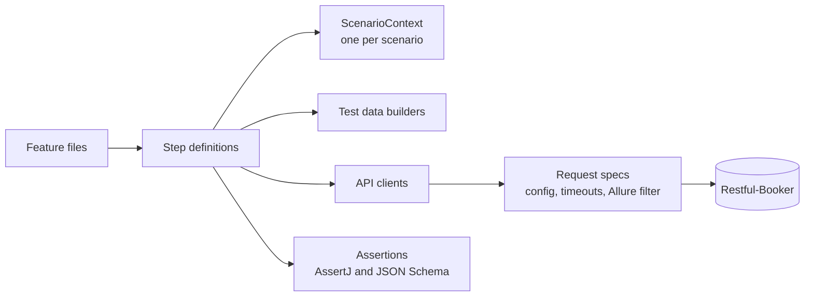

# Java API Test Framework

A Java API test automation framework built with REST Assured, Cucumber, JUnit 5, Gradle and Allure, running against the
public [Restful-Booker](https://restful-booker.herokuapp.com/apidoc/index.html) API.

## Quick Start

Requires JDK 21 (Gradle downloads one automatically if it's missing).

```bash
./gradlew test                                  # full suite against the public API
./gradlew test -Dcucumber.filter.tags="@smoke"  # only smoke scenarios
./gradlew test -Dcucumber.filter.tags="@booking and not @negative"
```

View the report locally with the [Allure CLI](https://allurereport.org/docs/install/):

```bash
allure serve build/alllure-results
```

A plain Cucumber HTML report is also written to `build/reports/cucumber/cucumber.html`.

## How it is built

